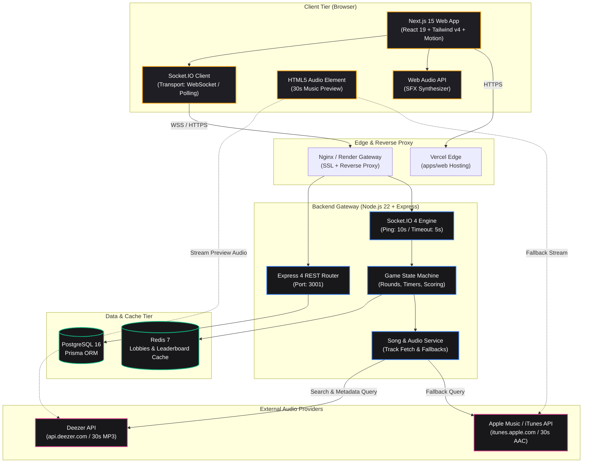
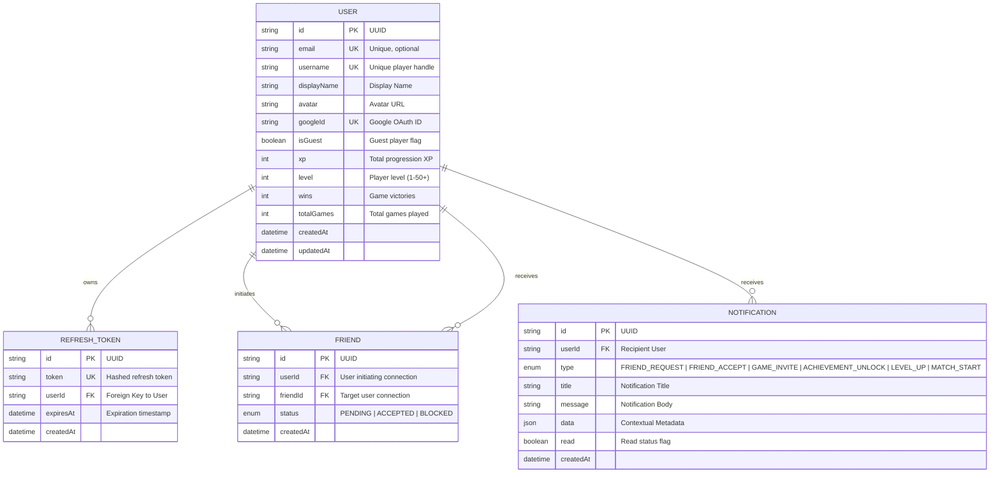
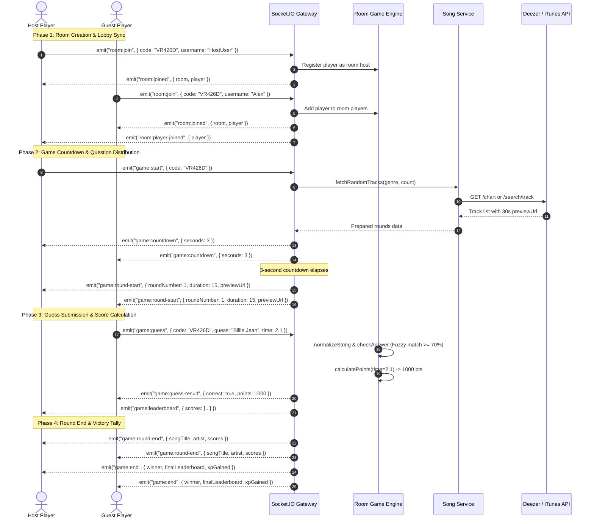
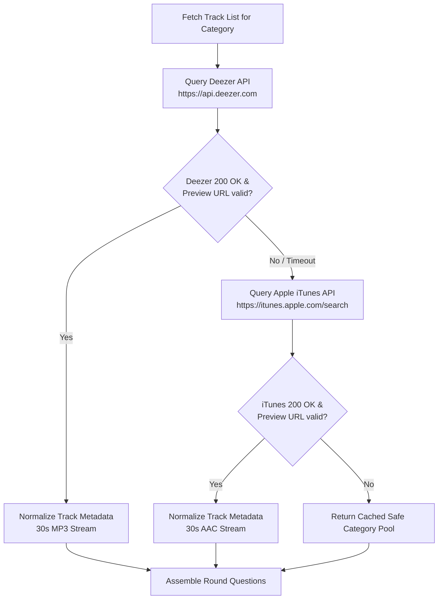

# SongGame System Architecture & Specifications

Comprehensive High-Level Design (HLD) and Low-Level Design (LLD) specification for SongGame — real-time multiplayer music trivia platform.

---

## 1. High-Level Design (HLD)

### 1.1 System Architecture

SongGame operates on a distributed real-time architecture composed of:
1. **Next.js 15 Web Client**: App Router, React 19, Motion, and WebGL shader runtime.
2. **Express & Socket.IO Gateway**: Handles real-time room synchronization, game lifecycle ticks, scoring calculations, and REST APIs.
3. **Data & State Tier**: PostgreSQL 16 (persistent user accounts, progression, friends, notifications) and Redis 7 (room caching, ephemeral rate limits, leaderboards).
4. **External Audio Services**: Deezer API and Apple Music / iTunes Search API for 30-second legal audio preview streams.

---

## 2. Low-Level Design (LLD)

### 2.1 Database Architecture (ERD)

The relational schema is managed using **Prisma 6.0** targeting PostgreSQL:

---

### 2.2 Real-Time Game Lifecycle Sequence Flow

The core game loop handles room synchronization, question distribution, audio clip streaming, buzzer/guessing, speed-decay scoring, and leaderboard broadcasts:

---

### 2.3 Audio Fallback Pipeline

Song preview clips are fetched with automatic fault-tolerant fallback:

---

## 3. Scoring & Progression Mathematical Models

### 3.1 Speed-Decay Scoring Formula

Points awarded per correct answer are strictly tiered based on response elapsed time $t$ in seconds:

$$\text{Points}(t) = \begin{cases} 
1000 & \text{if } t \le 3.0\text{s} \quad \text{(Speed Bonus)} \\
700 & \text{if } 3.0\text{s} < t \le 6.0\text{s} \quad \text{(Fast Guess)} \\
500 & \text{if } 6.0\text{s} < t \le t_{\max} \quad \text{(Standard Correct)} \\
0 & \text{otherwise}
\end{cases}$$

### 3.2 Answer Normalization & Fuzzy Matching

Answers undergo regex sanitization:
1. Strip all non-alphanumeric characters: `/[^a-z0-9\s]/g`
2. Collapse whitespace: `/\s+/g`
3. Convert to lowercase and trim.
4. If exact match fails, word tokenization checks overlap:
   $$\text{Match Ratio} = \frac{|\text{Tokens}_{\text{guess}} \cap \text{Tokens}_{\text{correct}}|}{\min(|\text{Tokens}_{\text{guess}}|, |\text{Tokens}_{\text{correct}}|)} \ge 0.70$$

### 3.3 Level Threshold Progression

Levels $L \in [1, 50]$ are computed from total accumulated experience points ($\text{XP}$):

$$T = [0, 100, 300, 600, 1000, 1500, 2100, 2800, 3600, 4500, 5500, \dots]$$

Level $L$ is the largest index $i$ such that $\text{XP} \ge T[i-1]$. Progression percentage is calculated as:

$$\text{Progress} = \frac{\text{XP} - T[L-1]}{T[L] - T[L-1]}$$
